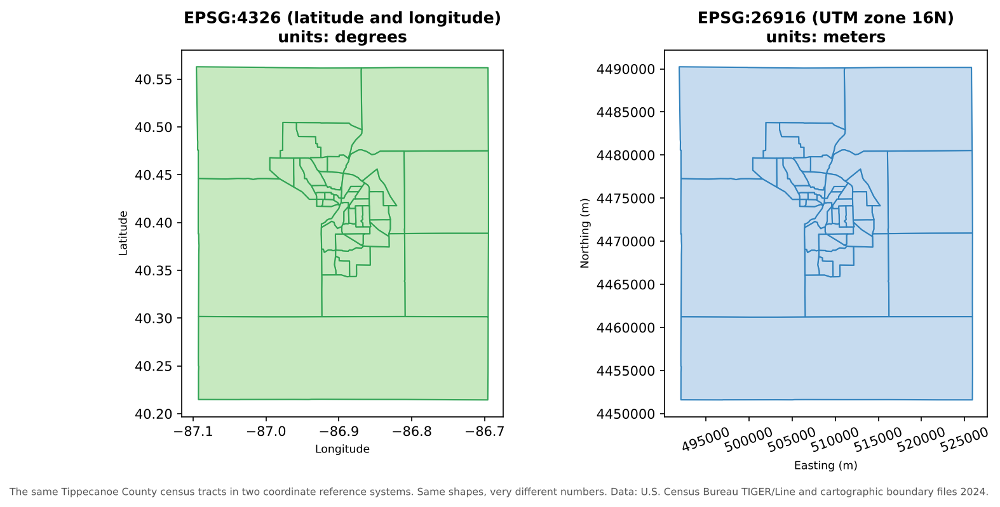

:::::::::::::::::::::::::::::::::::::: questions

- What is a coordinate reference system, and why does every layer need one?
- What is the difference between geographic and projected coordinate systems?
- What are EPSG codes, and which ones will I meet most often?
- Why do layers sometimes appear in the wrong place, and how do I fix it?

::::::::::::::::::::::::::::::::::::::::::::::::

::::::::::::::::::::::::::::::::::::: objectives

- Explain the parts of a coordinate reference system: datum, coordinate system and units
- Distinguish geographic from projected coordinate systems and know when to use each
- Recognize common EPSG codes for work in the United States
- Distinguish **defining** a coordinate system from **reprojecting** data, and avoid the classic mistakes

::::::::::::::::::::::::::::::::::::::::::::::::

## Coordinates need context

The numbers `507575, 4474900` and `-86.9107, 40.4247` describe the **same place**: the Purdue Memorial Union.
The first pair is in meters in one system; the second is in degrees in another. Coordinates only mean
something together with their **coordinate reference system** (CRS), which says how the numbers relate to
locations on Earth.

{alt="Two maps of the same Tippecanoe County census tracts. Left, in EPSG:4326, with axes in degrees: longitude from about -87.1 to -86.7 and latitude from about 40.2 to 40.55. Right, in EPSG:26916, with axes in meters: easting from about 492,000 to 526,000 and northing from about 4,451,000 to 4,490,000. The shapes look almost identical but the numbers are completely different."}

Managing the CRS of every layer is one of the most important, and most often neglected, parts of managing
geospatial data.

## The parts of a CRS

| Part | What it does | Examples |
|---|---|---|
| **Datum** | A model of the Earth's shape (an ellipsoid) and how it is anchored to the real Earth | WGS 84 (used by GPS), NAD83 (the official datum for North America) |
| **Coordinate system** | How positions are expressed: angles on the ellipsoid, or x and y on a flat projection | Latitude and longitude; UTM easting and northing |
| **Units** | The units of the coordinates | Degrees, meters, U.S. survey feet |
| **Projection** (projected systems only) | The mathematical method for flattening the curved Earth | Transverse Mercator, Albers Equal Area, Lambert Conformal Conic |

Different datums place the same point at slightly different coordinates. In the contiguous United States,
NAD83 and WGS 84 differ by about one to two meters: irrelevant for a state map, but important for surveying or
precise field data.

## Geographic and projected systems

| | Geographic CRS | Projected CRS |
|---|---|---|
| Coordinates | Latitude and longitude | x (easting) and y (northing) |
| Units | Degrees | Usually meters or feet |
| Shape of Earth | Curved (a 3D ellipsoid) | Flat (a 2D plane) |
| Good for | Storing and exchanging data, global datasets, GPS | Measuring distances and areas, analysis, local mapping |
| Example | EPSG:4326 (WGS 84) | EPSG:26916 (NAD83 / UTM zone 16N) |

A degree of longitude is about 111 km at the equator but only about 85 km in Indiana, and it shrinks to zero
at the poles. So **distances and areas calculated in degrees are meaningless**. Before measuring anything,
reproject to a suitable projected CRS.

Every projection distorts something: **area**, **shape**, **distance** or **direction**. Choose one that
preserves what your analysis needs:

- **Equal-area** projections (such as Albers) for comparing areas and densities across a large region
- **Conformal** projections (such as UTM or Lambert Conformal Conic) for local shapes and angles
- **UTM zones** and **State Plane** zones for accurate local measurements

## EPSG codes

Every common CRS has a numeric code in the **EPSG** registry (originally compiled by the European Petroleum
Survey Group). Using codes avoids ambiguity: "UTM" alone is not enough, but `EPSG:26916` is exact.

| EPSG code | Name | Use |
|---|---|---|
| 4326 | WGS 84 (latitude and longitude) | GPS, GeoJSON, most web data, global datasets |
| 4269 | NAD83 (latitude and longitude) | U.S. federal data, including Census TIGER/Line files |
| 3857 | WGS 84 / Pseudo-Mercator | Web map tiles (Google, OpenStreetMap, Esri). For display only: areas are badly distorted |
| 5070 | NAD83 / Conus Albers | Equal-area maps and analysis of the contiguous United States |
| 26916 | NAD83 / UTM zone 16N | Accurate local measurement in Indiana and neighboring states |
| 32616 | WGS 84 / UTM zone 16N | The same zone on the WGS 84 datum |

You can look up any code, and find the right one for an area, at <https://epsg.io/>.

## How the CRS is stored

- In a **shapefile**, the CRS is in the separate `.prj` file.
- In a **GeoPackage** or **GeoTIFF**, it is stored inside the file.
- **GeoJSON** (RFC 7946) is always in WGS 84 longitude and latitude.
- A **CSV** of coordinates stores no CRS at all: you must document it, for example in a column name
  (`lon_wgs84`) and in the README.

## Defining versus reprojecting

These two operations sound similar but do very different things:

| | Defining (assigning) a CRS | Reprojecting (transforming) |
|---|---|---|
| What it does | Tells the software which CRS the coordinates are **already** in | **Calculates new coordinates** in a different CRS |
| Changes the numbers? | No | Yes |
| When to use | The CRS is missing or wrong, and you know the correct one | You need the data in another CRS for analysis or to match other layers |
| In QGIS | Layer Properties > Source > Assigned Coordinate Reference System, or the **Assign projection** tool | **Reproject layer** tool, or **Export > Save Features As...** with a new CRS |

The classic mistake is to **define** a CRS when you meant to **reproject**. The numbers stay the same, but the
software now believes they mean something else, and the layer jumps to the wrong place (or the wrong
continent).

::::::::::::::::::::::::::::::::::::: callout

## On-the-fly reprojection can hide problems

QGIS reprojects every layer **on the fly** to the project's CRS, so layers in different systems still draw in
the right place. That is convenient, but it can hide the fact that your layers differ. Tools that combine
layers (clip, join by location, distance and network tools) work best, and sometimes only work correctly,
when the layers share one projected CRS. Some tools also report results in the **project's** units. Before
analysis, reproject every layer to the same projected CRS and set the project to it.

::::::::::::::::::::::::::::::::::::::::::::::::

## Troubleshooting checklist

| Symptom | Likely cause | Fix |
|---|---|---|
| Layer appears near 0° latitude, 0° longitude (off West Africa) | Projected coordinates (meters) read as degrees, or a missing CRS | Find the correct CRS and **define** it |
| Layer is shifted by a meter or two | Datum mismatch (for example NAD27 and NAD83, or NAD83 and WGS 84 with no transformation) | Use the right datum transformation when reprojecting |
| Areas or distances are tiny numbers such as 0.0002 | Calculated in degrees | Reproject to a projected CRS first |
| Areas look far too large near the poles | Calculated in Web Mercator (EPSG:3857) | Use an equal-area projection |
| Layer will not appear at all | Coordinates in the wrong order (latitude, longitude swapped) | Check which column is x and which is y |

::::::::::::::::::::::::::::::::::::: challenge

## Define or reproject?

For each situation, should you define (assign) the CRS or reproject the data?

1. You receive a shapefile with no `.prj`, and the metadata says the data is in NAD83 / UTM zone 16N.
2. Your census tracts are in NAD83 latitude and longitude, and you need to calculate their areas in square
   kilometers.
3. Your field points were collected in WGS 84, and the rest of the project is in EPSG:26916.

:::::::::::::::: solution

1. **Define** EPSG:26916. The coordinates are already in that system; the software just does not know it.
2. **Reproject** to an equal-area projected CRS (such as EPSG:5070) or a local one (EPSG:26916), then calculate
   areas.
3. **Reproject** the points to EPSG:26916 so every layer shares one projected CRS.

:::::::::::::::::::::::::

::::::::::::::::::::::::::::::::::::::::::::::::

::::::::::::::::::::::::::::::::::::: challenge

## Read the coordinates

Without opening a GIS, which CRS is each of these coordinate pairs probably in?

1. `(-86.91, 40.42)`
2. `(507575, 4474900)`
3. `(-9675000, 4928000)`

:::::::::::::::: solution

1. **Geographic** (latitude and longitude, such as EPSG:4326 or 4269): small numbers within -180 to 180 and
   -90 to 90.
2. **UTM** (here zone 16N): eastings around 500,000 m and northings in the millions of meters.
3. **Web Mercator** (EPSG:3857): coordinates in meters from the equator and the prime meridian, with large
   negative x values in the Western Hemisphere.

:::::::::::::::::::::::::

::::::::::::::::::::::::::::::::::::::::::::::::

::::::::::::::::::::::::::::::::::::: keypoints

- Coordinates are meaningless without their coordinate reference system: datum, coordinate system, units and projection
- Store and exchange data in geographic systems; measure and analyze in projected ones
- Use EPSG codes to name CRSs exactly; 4326, 4269, 3857, 5070 and 26916 are common in U.S. work
- Defining a CRS labels existing coordinates; reprojecting calculates new ones. Confusing the two moves data to the wrong place
- Before analysis, put every layer, and the project, in the same projected CRS

::::::::::::::::::::::::::::::::::::::::::::::::
