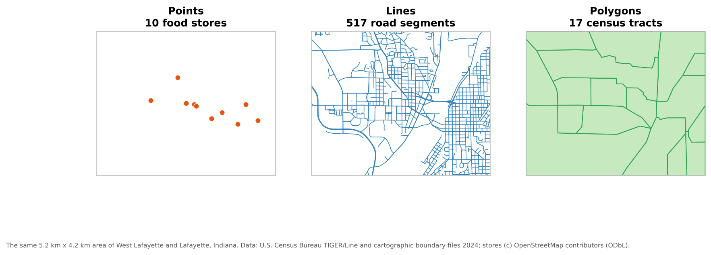
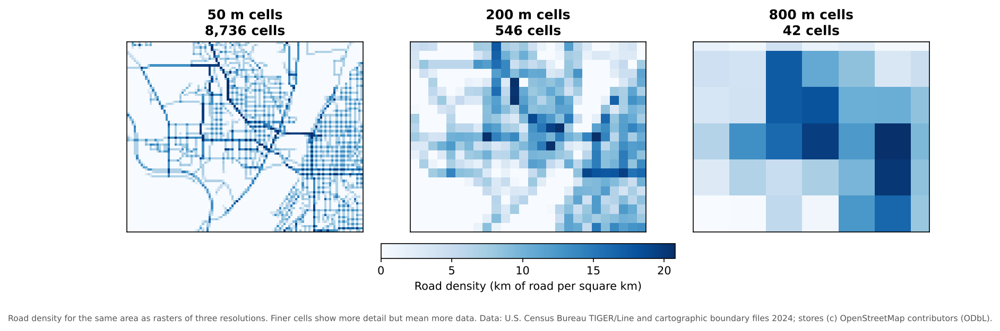

:::::::::::::::::::::::::::::::::::::: questions

- How do computers represent places and features?
- What are vector and raster data, and when should I use each?
- How does map scale affect how a feature should be represented?

::::::::::::::::::::::::::::::::::::::::::::::::

::::::::::::::::::::::::::::::::::::: objectives

- Describe the three vector geometry types and how attributes are attached to them
- Explain raster cells, resolution, bands and NoData values
- Choose an appropriate data model and geometry for a research question
- Explain what topology is and why it matters

::::::::::::::::::::::::::::::::::::::::::::::::

## Two ways to describe the world

A GIS has to turn a messy, continuous world into data a computer can store. There are two main approaches,
called **data models**:

- **Vector**: the world is made of discrete **features** (a store, a road, a county) with exact boundaries,
  each described by coordinates and a row of attributes.
- **Raster**: the world is a **surface** divided into a grid of equal cells, and every cell holds a value
  (an elevation, a temperature, a land cover class, a color).

A third, very common kind of data is the plain **table** with no geometry at all, such as a spreadsheet of
census counts. It becomes spatial when it is **joined** to a vector layer through a shared ID.

## Vector data

### Geometry

Vector features come in three basic geometry types:

| Geometry | Stored as | Dimensions | Examples |
|---|---|---|---|
| **Point** | One x, y coordinate pair | None (a location) | Stores, wells, survey respondents, cell towers |
| **Line** (polyline) | An ordered list of points (vertices) | Length | Roads, rivers, transit routes, trails |
| **Polygon** | A closed ring of vertices, possibly with holes | Area and perimeter | Census tracts, parcels, lakes, building footprints |

{alt="Three panels of the same area of West Lafayette and Lafayette, Indiana. Left, points: 10 orange dots for food stores. Middle, lines: a dense blue network of 517 road segments. Right, polygons: 17 green census tracts outlined in darker green."}

There are also **multi-part** versions (a multipoint, a multiline, or a multipolygon such as Hawaii, which is
one state made of several islands). Most file formats require all features in one layer to share the same
geometry type, so stores, roads and tracts go in **separate layers**.

### Attributes

Each feature has a row in an **attribute table**. The geometry says *where*; the attributes say *what*. A
made-up example:

| fid | store_name | store_type | snap_accepted | geometry |
|---|---|---|---|---|
| 1 | Example Supermarket | Supermarket | Yes | POINT (-86.9088 40.4539) |
| 2 | Example Market | Small market | Unknown | POINT (-86.9025 40.3863) |
| 3 | Example Corner Stop | Convenience | No | POINT (-86.8930 40.4190) |

Designing those attributes well is the subject of the **Designing Your Data** episode.

### Topology

**Topology** describes how features relate to each other: which polygons share a boundary, which lines meet
at a junction, which point lies inside which polygon. Some data models store topology explicitly; most
everyday formats (shapefile, GeoPackage, GeoJSON) store each feature independently and leave you to check that
neighbors line up. Topology matters whenever the analysis depends on connections:

- Network analysis needs road lines that actually meet at intersections
- Neighboring census tracts should share boundaries exactly, with no gaps or overlaps
- Each point should fall inside exactly one polygon of a zoning layer

The **Data Quality** episode shows common topology errors and how to find them.

## Raster data

A raster is a grid of **cells** (or **pixels**), stored row by row. Its key properties are:

| Property | Meaning | Example |
|---|---|---|
| **Cell size** (spatial resolution) | The ground width of one cell | 10 m for Sentinel-2, 30 m for Landsat |
| **Extent** | The area the grid covers | One county, one satellite scene |
| **Bands** | Layers of values for the same cells | Red, green, blue and near-infrared bands of an image |
| **Data type** | What kind of number each cell holds | 8-bit integers (0 to 255) for a photo; 32-bit decimals for temperature |
| **NoData value** | A special value meaning "no information here" | -9999, or areas outside the image |

{alt="Three blue raster maps of road density for the same area. With 50 meter cells (8,736 cells) individual streets are visible. With 200 meter cells (546 cells) the pattern of dense neighborhoods is blocky but clear. With 800 meter cells (42 cells) only a coarse pattern remains."}

Halving the cell size multiplies the number of cells by four, so resolution has a direct cost in storage and
processing time. Choose the coarsest resolution that still answers your question.

Rasters come in two broad kinds:

- **Continuous** rasters hold measured quantities that vary smoothly: elevation, temperature, rainfall,
  reflectance in a satellite band.
- **Categorical** (discrete) rasters hold classes: land cover type, soil type, a zoning code. Their values are
  labels, so averaging them makes no sense.

::::::::::::::::::::::::::::::::::::: callout

## NoData is not zero

A NoData cell means "unknown", while 0 can be a real value (0 mm of rain, 0 m elevation at sea level). If the
NoData value is not set correctly, a GIS will treat missing areas as real data and averages will be wrong.
Always check a raster's NoData value when you first open it.

::::::::::::::::::::::::::::::::::::::::::::::::

## Choosing a data model

| Question | Usually best as |
|---|---|
| Where are the grocery stores, and what are they like? | Vector points |
| How long is the route to the nearest store? | Vector lines (a network) |
| How many households in each tract have no car? | Vector polygons joined to a table |
| How hot is each part of the city on a summer afternoon? | Raster (continuous) |
| What is the land cover around each school? | Raster (categorical), summarized to vector buffers |

You can convert between models (**rasterize** vector data, or **vectorize** a raster), but every conversion
loses something: rasterizing blurs exact boundaries to the cell size, and vectorizing a raster produces
blocky, stair-stepped polygons.

## Scale and generalization

How a feature should be represented depends on the **scale** of the map or analysis:

- A city is a **point** on a map of the United States, but a **polygon** on a map of Indiana.
- A river is a **line** on a state map, but a **polygon** (with two banks) on a detailed city map.
- A building is a **point** in a regional study of businesses, but a **polygon** in a study of floor area.

Data made for small-scale maps is usually **generalized**: lines are simplified and small features dropped.
The Census Bureau's 1:20,000,000 cartographic boundary files are a good example. Generalized data looks fine
on a national map but is not accurate enough for measuring distances or areas at the neighborhood level. Use
data whose level of detail matches your analysis.

::::::::::::::::::::::::::::::::::::: challenge

## Pick the model and geometry

How would you represent each of these, and why?

1. Bus stops in a city
2. Average annual rainfall across Indiana
3. School attendance zones
4. Hiking trails in a state park
5. Land cover (forest, farmland, urban, water) for a county

:::::::::::::::: solution

1. **Vector points**: discrete locations with attributes such as routes served.
2. **Raster (continuous)**: rainfall varies smoothly across space.
3. **Vector polygons**: each zone has a clear boundary and attributes such as school name.
4. **Vector lines**: trails have length and connect at junctions; topology matters for routing.
5. **Raster (categorical)**: land cover is usually classified from satellite imagery, cell by cell. It can be
   converted to polygons for some uses, at the cost of blocky edges.

:::::::::::::::::::::::::

::::::::::::::::::::::::::::::::::::::::::::::::

::::::::::::::::::::::::::::::::::::: challenge

## Resolution and storage

A single-band raster covering a 50 km by 50 km county has 30 m cells and stores each cell in 4 bytes. About how
large is it? What happens if you switch to 10 m cells?

:::::::::::::::: solution

50,000 m / 30 m is about 1,667 cells on each side, or about 2.8 million cells. At 4 bytes each, that is about
11 MB. With 10 m cells there are 5,000 cells per side, or 25 million cells, about 100 MB: nine times larger,
because resolution improved three times in **both** directions. Multi-band images multiply this again by the
number of bands.

:::::::::::::::::::::::::

::::::::::::::::::::::::::::::::::::::::::::::::

::::::::::::::::::::::::::::::::::::: keypoints

- Vector data represents discrete features as points, lines or polygons, each with a row of attributes
- Raster data represents surfaces as a grid of cells with a resolution, bands, a data type and a NoData value
- Topology describes how features connect and share boundaries; network and boundary analysis depend on it
- The right data model and geometry depend on the question and the scale of the analysis
- Finer raster resolution grows data size with the square of the change in cell size

::::::::::::::::::::::::::::::::::::::::::::::::
