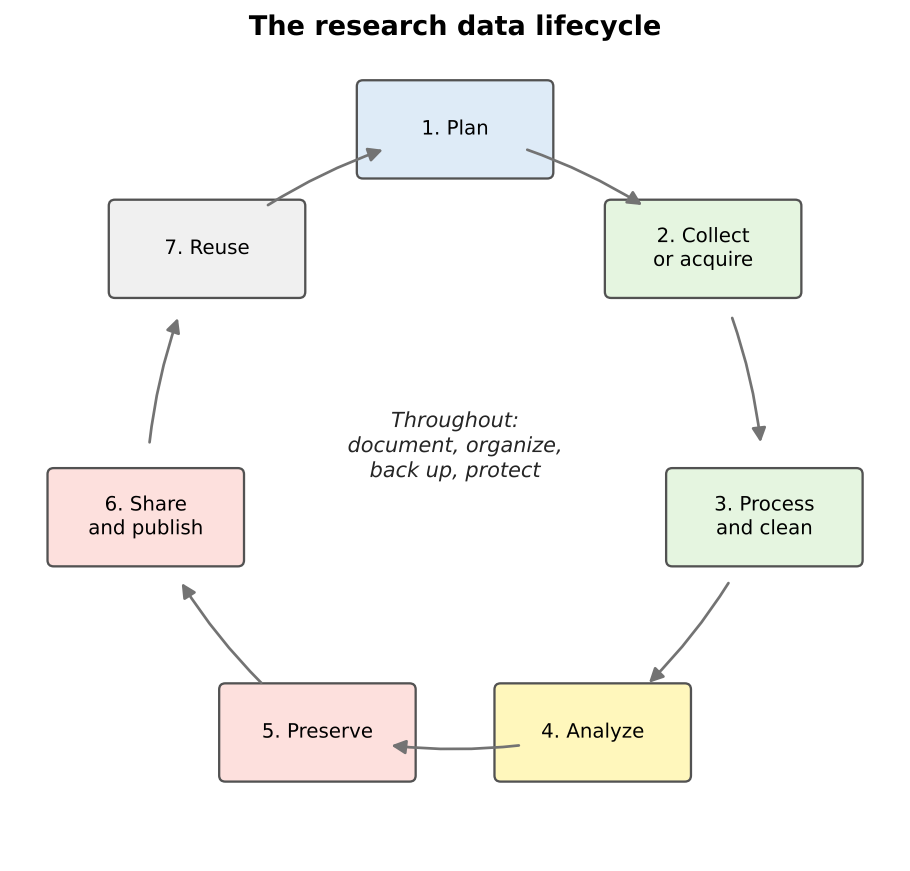

:::::::::::::::::::::::::::::::::::::: questions

- What is research data management, and why does it matter for geospatial work?
- What are the stages of the research data lifecycle?
- What is a data management plan, and when is one required?

::::::::::::::::::::::::::::::::::::::::::::::::

::::::::::::::::::::::::::::::::::::: objectives

- Define research data management and distinguish it from data curation
- Describe the stages of the research data lifecycle
- List the main sections of a data management plan
- Explain why geospatial data needs particular care

::::::::::::::::::::::::::::::::::::::::::::::::

## What is data management?

**Research data management** is everything you do to organize, store, protect and maintain data while a
project is under way, so that the data stays usable, trustworthy and safe. It covers practical questions such
as:

- Where will the files live, and who can reach them?
- What will the files and folders be called?
- How will we know which version is the latest?
- What happens if a laptop is lost or a hard drive fails?
- How will someone else (or you, in a year) understand what each column means?

Good data management is not glamorous, but almost every researcher has a story of the alternative: a
shapefile that no longer lines up, a folder of files called `final_v3_REAL.shp`, or a thesis chapter that
could not be reproduced because the cleaned data was overwritten.

### Management and curation

This module and the **Data Curation** module are closely related:

| | Data management (this module) | Data curation |
|---|---|---|
| Focus | Day-to-day handling of data **during** a project | Making data understandable and usable **beyond** the project |
| Main tasks | Data models, formats, coordinate systems, organization, versions, backups, quality | Metadata, documentation, preservation, sharing, ethics |
| Main user | You and your team | Future users, including strangers and your future self |

In practice they overlap, and both start on the first day of a project, not at the end.

## The research data lifecycle

Data passes through stages that are often drawn as a cycle, because published data is reused to start new
projects.

{alt="A cycle of seven boxes connected by arrows: 1 Plan, 2 Collect or acquire, 3 Process and clean, 4 Analyze, 5 Preserve, 6 Share and publish, 7 Reuse, which leads back to Plan. In the center: throughout, document, organize, back up, protect."}

| Stage | Geospatial example |
|---|---|
| **Plan** | Decide what layers you need, their coordinate system, file format and naming scheme |
| **Collect or acquire** | Download census tracts, digitize features from a scanned map, collect points with QField |
| **Process and clean** | Reproject layers, fix invalid geometries, join tables, remove duplicates |
| **Analyze** | Calculate distances, densities or statistics; make maps |
| **Preserve** | Save final datasets in stable, open formats with documentation |
| **Share and publish** | Deposit the data in a repository with a DOI and a license |
| **Reuse** | You, or others, start a new project from the published data |

Some activities happen at **every** stage: documenting what you did, keeping files organized, backing them
up, and protecting sensitive information.

## Why geospatial data needs extra care

Geospatial data has all the problems of ordinary data, and a few of its own:

- **Many files make one dataset.** A shapefile is at least three files that must travel together.
- **Coordinates mean nothing without a coordinate reference system.** The same numbers can describe places
  hundreds of kilometers apart.
- **Data is often large.** Imagery, elevation models and lidar can reach gigabytes or terabytes.
- **Geometry can be invalid** in ways a spreadsheet never is: polygons that cross themselves, gaps between
  neighbors, lines that do not connect.
- **Location can be sensitive.** A point can reveal where a person lives, works or receives care.
- **Software projects link to data by path.** Move a folder and a QGIS project can lose its layers.

The rest of this module takes these one at a time.

## Data management plans

A **data management plan** (DMP) is a short document, written before a project starts, that describes what
data will be created and how it will be handled, shared and preserved. Many funders require one:

- The **U.S. National Science Foundation (NSF)** requires a two-page **Data Management and Sharing Plan**
  with every proposal. If a project will not produce data, the proposal must explain why instead.
- The **National Institutes of Health (NIH)** has required a Data Management and Sharing Plan for research
  that generates scientific data since January 2023.
- A 2022 memorandum from the White House Office of Science and Technology Policy (the "Nelson memo") directed
  federal agencies to make publications, and the data underlying them, publicly available without delay;
  agencies were asked to have updated policies in effect by the end of 2025.

Even when no funder asks for one, a DMP is a useful planning tool for a thesis or a team project.

### What goes into a DMP

NSF's guidance asks the plan to describe:

1. **The data**: what types of data, samples, software and other materials the project will produce
2. **Standards**: the formats and metadata standards that will be used
3. **Access and sharing**: how and when data will be shared, and how privacy, confidentiality, security
   and intellectual property will be protected
4. **Reuse**: policies for reuse, redistribution and derivative works
5. **Archiving**: how the data will be preserved and kept accessible

For a geospatial project, a good plan also names the **coordinate reference system**, the **file formats**,
the expected **data volume**, and how any **sensitive locations** will be protected. Free tools such as
[DMPTool](https://dmptool.org/) provide templates for each funder, and many university libraries (including
Purdue's) offer help writing plans.

::::::::::::::::::::::::::::::::::::: callout

## Data management is a team responsibility

On a team project, decide early who is responsible for each task: who keeps the master copy, who approves
changes to the schema, who checks backups. Write it down. "Everyone" usually means "no one".

::::::::::::::::::::::::::::::::::::::::::::::::

::::::::::::::::::::::::::::::::::::: challenge

## Spot the risks

A graduate student keeps all of her thesis data in the Downloads folder of her laptop. Files have names such
as `tracts.shp`, `tracts2.shp`, `tracts_new.shp` and `export.csv`. She sometimes edits the original census
download directly. Name at least four risks, and a fix for each.

:::::::::::::::: solution

- **No backup**: if the laptop is lost or fails, everything is gone. Keep at least one other copy, ideally
  off-site or in institutional cloud storage.
- **Unclear names and versions**: nobody can tell which `tracts` file is current or how they differ. Use
  descriptive names with dates or version numbers, and keep a short change log.
- **Raw data edited in place**: the original can never be recovered. Keep raw data read-only and save
  changes as new files.
- **Disorganized location**: the Downloads folder mixes project files with everything else. Use a dedicated
  project folder with a clear structure.
- **No documentation**: there is no record of where `export.csv` came from or what its columns mean. Add a
  README and a data dictionary.

:::::::::::::::::::::::::

::::::::::::::::::::::::::::::::::::::::::::::::

::::::::::::::::::::::::::::::::::::: challenge

## Draft a mini plan

Pick a project you are working on, or imagine mapping grocery store access in your town. In five bullet
points, one for each DMP section above, describe how you would manage the data.

:::::::::::::::: solution

An example for a grocery access project:

1. **Data**: census tract boundaries and ACS tables (downloaded), grocery store points (field collected),
   road network (downloaded), maps and scripts.
2. **Standards**: GeoPackage for vector data, CSV for tables, EPSG:26916 for analysis, ISO 19115 metadata
   written in QGIS.
3. **Access and sharing**: store points shared openly after verification; no personal information collected.
4. **Reuse**: data released under a CC BY 4.0 license; OpenStreetMap-derived layers keep the ODbL.
5. **Archiving**: final datasets deposited in an institutional repository with a DOI.

:::::::::::::::::::::::::

::::::::::::::::::::::::::::::::::::::::::::::::

::::::::::::::::::::::::::::::::::::: keypoints

- Data management is the day-to-day organization, storage, protection and maintenance of data during a project
- The research data lifecycle runs from planning through collection, processing, analysis, preservation, sharing and reuse
- Geospatial data needs extra care: multi-file formats, coordinate systems, large sizes, geometry validity and sensitive locations
- Many funders, including NSF and NIH, require a data management and sharing plan, and a plan is worth writing even when not required

::::::::::::::::::::::::::::::::::::::::::::::::
