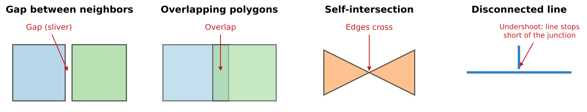

:::::::::::::::::::::::::::::::::::::: questions

- What does "quality" mean for geospatial data?
- What kinds of errors are common in vector data?
- How can I check and improve the quality of a dataset?

::::::::::::::::::::::::::::::::::::::::::::::::

::::::::::::::::::::::::::::::::::::: objectives

- Describe the elements of spatial data quality
- Recognize invalid geometries and topology errors
- Plan a quality assurance and quality control workflow
- Record quality checks so others can judge fitness for use

::::::::::::::::::::::::::::::::::::::::::::::::

## Quality means "fit for use"

No dataset is perfect. A road layer accurate to 10 meters is excellent for a regional access study and useless
for engineering a new intersection. **Data quality** is therefore about **fitness for use**: is the data good
enough for *this* purpose, and do we know its limitations?

## The elements of spatial data quality

International standard ISO 19157 (endorsed by the U.S. Federal Geographic Data Committee) describes data
quality through a set of elements. In plain terms:

| Element | Question | Grocery store example |
|---|---|---|
| **Completeness** | Is anything missing (omission) or extra (commission)? | A new store is missing; a closed store is still listed |
| **Logical consistency** | Does the data follow its own rules: domains, formats, topology? | `store_type` contains "gas station", which is not in the domain |
| **Positional accuracy** | How close are the coordinates to the true location? | A point is 40 m from the store, in the parking lot |
| **Thematic (attribute) accuracy** | Are the attribute values correct? Are the classes right? | A store marked as accepting SNAP does not |
| **Temporal quality** | Is the data current, and are dates correct and consistent? | Hours were recorded three years ago |
| **Usability** | Overall, can it be used for the intended purpose? | Good enough for a city-wide access study? |

A further, essential piece of information is **lineage**: where the data came from and what was done to it.
Without lineage, nobody can judge the other elements. (Lineage is recorded in metadata; see the Data Curation
module.)

## Geometry errors

Vector geometry has rules. A polygon's boundary must close and must not cross itself; neighboring polygons in a
layer such as census tracts should not overlap or leave gaps. Data that breaks these rules can make tools fail
or, worse, quietly give wrong answers.

{alt="Four small diagrams. Gap between neighbors: two squares with a thin empty sliver between them, labeled gap. Overlapping polygons: two rectangles that overlap in a shaded strip, labeled overlap. Self-intersection: a bowtie-shaped polygon whose edges cross in the middle. Disconnected line: a vertical line that stops just short of a horizontal line, labeled undershoot, line stops short of the junction."}

| Error | What it is | Typical cause | Why it matters |
|---|---|---|---|
| **Invalid geometry** (for example a **self-intersection**) | A polygon whose edges cross, or a ring that does not close | Careless digitizing, format conversion | Overlay, clip and area tools fail or return nonsense |
| **Gaps** and **slivers** | Thin empty spaces between polygons that should touch | Digitizing neighbors separately; mixing data of different scales | Points in the gap belong to no polygon; totals do not add up |
| **Overlaps** | Two polygons covering the same area | The same causes | Areas and counts are double-counted |
| **Undershoots** and **overshoots** (**dangles**) | Lines that stop short of, or cross past, the line they should meet | Digitizing without snapping | Network routes break or go the wrong way |
| **Duplicate features** | The same feature entered twice | Repeated imports; several data collectors | Counts and access measures are inflated |
| **Null or empty geometry** | A record with no shape | Failed edits or imports | The feature silently disappears from maps and analyses |

### Finding and fixing them in QGIS

QGIS has tools in the **Processing Toolbox** for each kind of problem:

- **Check validity** (Vector geometry group) lists invalid geometries and explains each error
- **Fix geometries** creates a repaired copy of a layer (always keep the original)
- The **Check geometry** group includes tools such as **Small gaps**, **Overlaps**, **Self-intersections**,
  **Dangle-end lines** and **Duplicated geometries**
- **Delete duplicate geometries** and **Delete duplicates by attribute** remove exact copies
- **Snapping** options (Project > Snapping Options) prevent undershoots and gaps while you digitize

Automatic fixes are a starting point, not an answer. Look at what was changed before trusting it.

## Attribute errors

Problems in the attribute table are at least as common as geometry problems:

- values outside the domain (misspellings, inconsistent capitalization, old categories)
- impossible values (a negative population, a store opening at 25:00, a percentage over 100)
- missing values, and missing values disguised as 0 or -9999
- IDs that are not unique, or that lost their leading zeros
- units mixed within a column (miles and kilometers, dollars and thousands of dollars)

Simple checks catch most of them: count the distinct values in each categorical field, look at the minimum
and maximum of each numeric field, and count nulls. In QGIS, **Vector > Analysis Tools > Basic Statistics for
Fields** and the **Statistics** panel do this quickly.

## Quality assurance and quality control

- **Quality assurance (QA)** prevents errors: a careful design, domains and dropdowns, required fields,
  snapping, training, and a test run before collecting.
- **Quality control (QC)** finds errors afterwards: validity and topology checks, attribute summaries,
  comparisons with another source, and field checks of a sample.

A practical QC routine for each new or updated dataset:

1. Confirm the **CRS** and that the layer lines up with a trusted reference layer.
2. Count features, and compare with what you expect.
3. Run **Check validity** and the relevant **Check geometry** tools.
4. Summarize each attribute: distinct values, ranges and nulls.
5. Look for **duplicates** by ID, by name and by location.
6. Check a **random sample** against a reference (imagery, a website, a field visit).
7. **Record** what you checked, what you found and what you changed.

::::::::::::::::::::::::::::::::::::: callout

## Report quality honestly

Every dataset has limitations. State them: "Store locations were collected with phone GPS (typically 3 to 10 m
accuracy); 12 of 64 stores were verified in the field in March 2026." This kind of statement does not weaken
your work. It lets others use your data correctly, and it is part of good metadata.

::::::::::::::::::::::::::::::::::::::::::::::::

::::::::::::::::::::::::::::::::::::: challenge

## Name the quality element

Which element of data quality does each problem affect?

1. A census tract layer is from 2010, but the analysis is about 2024.
2. Three stores were recorded twice by different volunteers.
3. A store's point is on the wrong side of a river.
4. `store_type` contains the values "Supermarket", "supermarket" and "Grocery".
5. Two new supermarkets that opened last year are missing.

:::::::::::::::: solution

1. **Temporal quality** (tract boundaries were redrawn for 2020)
2. **Completeness** (commission: extra records), and logical consistency if IDs are duplicated
3. **Positional accuracy**
4. **Logical consistency** (values outside the domain), and thematic accuracy if "Grocery" is a different
   category
5. **Completeness** (omission)

:::::::::::::::::::::::::

::::::::::::::::::::::::::::::::::::::::::::::::

::::::::::::::::::::::::::::::::::::: challenge

## Why did the total change?

A researcher sums the population of all tracts that intersect a city and gets a number 4% higher than the
city's official population. Give two possible data quality explanations.

:::::::::::::::: solution

- **Overlaps**: if some tract polygons overlap, people are counted twice.
- **Mismatched geometry**: tracts that only touch or slightly cross the city boundary (because of slivers or
  boundaries digitized at different scales) are included in full, adding people who live outside the city.
- **Temporal mismatch**: the tract populations and the official city figure may describe different years.

Checking overlaps, using tract centroids (or proper areal weighting) instead of "intersects", and matching
years would resolve it.

:::::::::::::::::::::::::

::::::::::::::::::::::::::::::::::::::::::::::::

::::::::::::::::::::::::::::::::::::: keypoints

- Data quality means fitness for a particular use, and every dataset has limitations
- The elements of quality are completeness, logical consistency, positional accuracy, thematic accuracy and temporal quality, with lineage recorded alongside
- Invalid geometries, gaps, overlaps, dangles and duplicates are common vector errors; QGIS has tools to find each
- Prevent errors with good design (QA) and find them with systematic checks (QC)
- Record what you checked and report limitations honestly

::::::::::::::::::::::::::::::::::::::::::::::::
